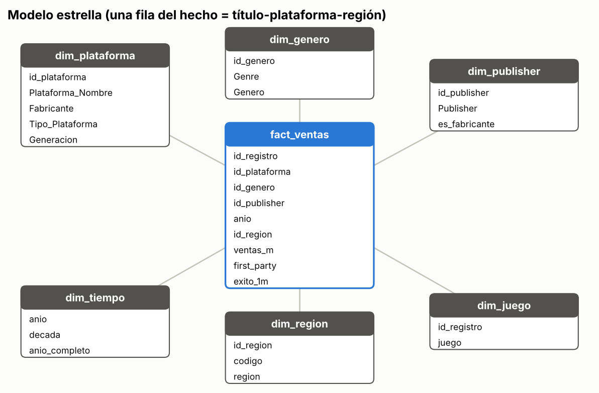
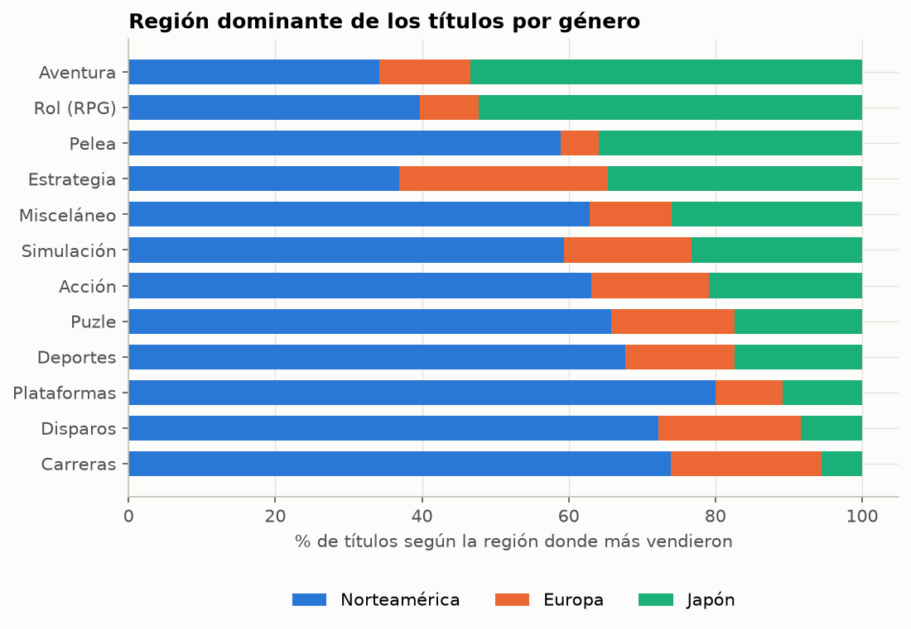
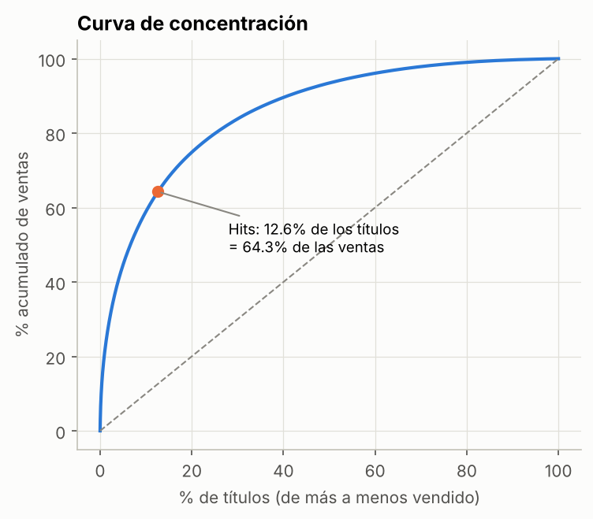
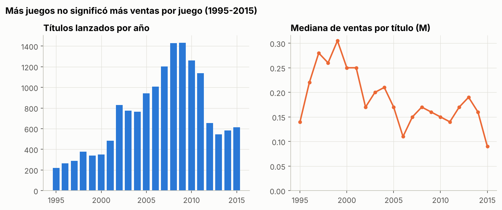
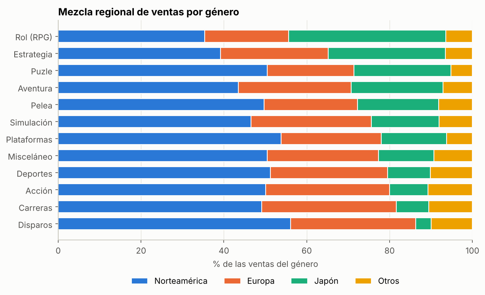
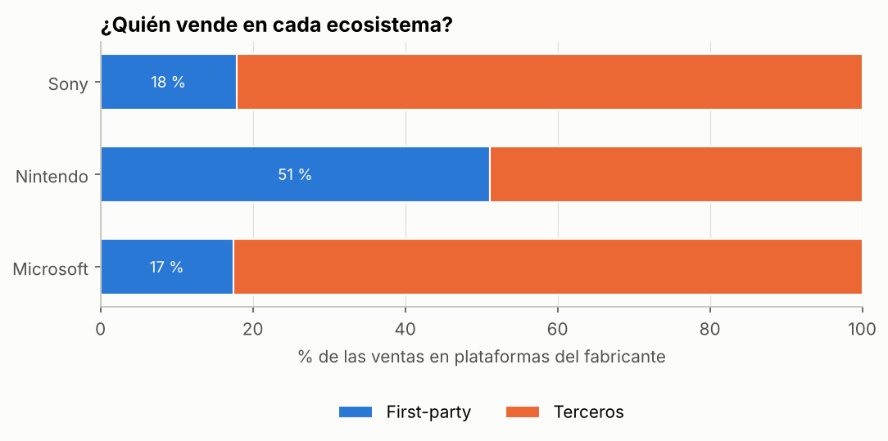

# Ventas de videojuegos

## Entrega 3

| Integrantes
|--
| Diego Alejandro Gómez Carmona 
| Jorge Elias Builes Chavarria 
| Juan Pablo Vasquez Tobon 
| Sergio Alvarez Hernandez 

Video: 

---

## Objetivo

Analizar el histórico de ventas de videojuegos entre 1980 y 2016. Tomamos el papel de un publisher mediano que tiene que elegir en qué géneros, plataformas y regiones invertir. 

Con lo anterior nos hicimos las siguientes preguntas:

1. Qué géneros venden más por título lanzado?
2. Las preferencias de género cambian según la región?
3. Los juegos del fabricante de la consola, los first-party, venden más que los de terceros?
4. Qué tan concentradas están las ventas en pocos títulos y publishers?
5. Cómo cambiaron los lanzamientos y las ventas por título con los años?

## Dataset

Video Game Sales: https://www.kaggle.com/datasets/gregorut/videogamesales

Hay 16.598 registros. Cada uno es un juego en una plataforma, con su año, género, publisher y ventas en millones de unidades para las regiones de Norteamérica, Europa, Japón, resto del mundo y total.

## Estructura del repositorio

En el repositori otendremos la data, tanto la raw como la procesada, los notebooks de cada fase, el dashboard final, los graficos que se generan de los notebooks y un archivo llamado "estilo" dentro de la carpeta src el cual nos ayuda a ahorrar codigo que se repite constantemente dentro de cada notebook.

## Metodología

**1.** Primera revision del dataset, tipos, nulos, distribución, años. Plantear un objetivo y que se espera responder con estos datos.

**2.** Preparación de los datos.

- 58 publishers nulos que se pasan  a Unknown.
- Un registro partido de Madden NFL 13 de PS3 con un duplicado exacto que se eliminado.
- 271 registros sin año se eliminan.
- 2016 se marca como año incompleto.
- Variables nuevas: fabricante, tipo y generación de la plataforma, década, first-party, región dominante, participación por región y éxito.

Quedaron 16.322 registros. Con eso se armó el modelo estrella.

**3. Hipotesis.** Como las ventas son muy asimétricas, la mayoria de los juegos tienen pocas ventas mientras que unos pocos tienen muchas. se usaron pruebas no paramétricas como, Kruskal-Wallis con post hoc de Dunn, chi-cuadrado de independencia y Mann-Whitney U.

**4. KPIs.** Siete indicadores conectados con las hipótesis, calculados en Python y replicados como medidas DAX para PowerBI.

**5. Dashboard.** Tres páginas en Power BI, resumen, géneros y regiones, ecosistemas, con segmentadores, filtrado y botones de navegación.

**6. Validación y storytelling.** Se repitieron las pruebas solo con la séptima generación de consolas para ver si los resultados se mantenían, y se hizo la narrativa y las recomendaciones.

## Resultados

### Pruebas de hipótesis

| Hipótesis (H1) | Prueba | Valor p | Efecto | Decisión |
|---|---|---|---|---|
| H1. Las ventas por título difieren según el género | Kruskal-Wallis | 6,1e-202 | ε² = 0,059 (pequeño) | Se rechaza H0 |
| H2. La región dominante de un juego depende de su género | Chi-cuadrado | < 1e-300 | V = 0,256 (moderado) | Se rechaza H0 |
| H2b. Japón pesa más en las ventas de los juegos de Rol | Mann-Whitney U | 1,6e-171 | r = 0,381 | Se rechaza H0 |
| H3. Los juegos first-party venden más que los de terceros | Mann-Whitney U | 8,5e-164 | r = 0,406 (moderado-grande) | Se rechaza H0 |

Las pruebas estan en notebooks/03_hipotesis.ipynb.

Los tres resultados se mantuvieron al repetir las pruebas solo con la séptima generación PS3, Xbox 360, Wii, DS, PSP.

### KPIs

| KPI | Valor | Relación |
|---|---|---|
| Ventas globales | 8.820 M de unidades | Base |
| Mediana de ventas por título | 0,17 M (el promedio es 0,54 M) | H1, H3 |
| Tasa de hits (títulos con 1 M o más) | 12,6 % | H1, H3 |
| Participación de los hits en las ventas | 64,3 % (con el 12,6 % de los títulos) | H1, H3 |
| Participación regional | NA 49,2 % · EU 27,3 % · JP 14,6 % · Otros 9,0 % | H2 |
| Afinidad de Rol en Japón | 2,60 | H2 |
| Prima first-party (mediana first-party / terceros) | 3,0 veces | H3 |

### Hallazgos principales

**Los videojuegos son un mercado de pocos éxitos.** Un juego típico vende 0,17 M y solo 1 de cada 8 llega al millón, y esos pocos hits generan el 64,3 % de las ventas.

**Más lanzamientos no trajeron más ventas por juego.** Entre 1997 y 2009 los lanzamientos por año se multiplicaron varias veces, pero la mediana por título bajó de 0,28 M a 0,16 M.

**El género depende en gran medida de la región** Plataformas 22 % y Disparos 19 %, tienen las tasas de hits más altas, y Aventura 3 % la más baja. El impacto del género sobre las ventas es pequeño, pero sobre la región es mas alto, Rol y Aventura dependen mucho de Japón, mientras que Disparos y Carreras casi no venden allá.

**Dominancia de los first-party** Los first-party venden 3 veces más en la mediana. En consolas de Nintendo la diferencia es de 6,6 veces y Nintendo se lleva el 51 % de las ventas de su propio ecosistema. En PlayStation y Xbox los terceros generan más del 80 %.

## Conclusiones

1. Las ventas de videojuegos están dominadas por pocos éxitos, así que el promedio no sirve para tomar decisiones, es por ello que se usa la madiana.
2. El género sí influye en cuánto vende un juego, pero no es concluyente. lo que mas peso tiene es definir el mercado objetivo, es decir, la región.
3. Para un publisher externo es más fácil competir en PlayStation y Xbox, donde los terceros se llevan más del 80 % de las ventas, que en Nintendo, donde Nintendo se queda con la mitad.
4.Preferir géneros con mejor tasa de hits si se quiere bajar riesgo, escoger la región según el género, Rol en Japón; Disparos y Carreras en Norteamérica y Europa y priorizar PlayStation y Xbox, donde el fabricante solo vende cerca del 18 % de los juegos, antes que Nintendo, donde vende la mitad.

### Limitaciones

- Son unidades físicas estimadas por VGChartz, sin ingresos, costos ni ventas digitales. de PC casi no hay información.
- El dataset llega solo hasta 2016 y ese año está incompleto.
- En los años antiguos solo quedaron registrados los juegos más conocidos.
- Un mismo juego lanzado en varias consolas aparece como varios registros, por ejemplo GTA V cuenta 5 veces, así que esas observaciones no son del todo independientes.
- Las pruebas muestran que las variables están relacionadas, no que una cause la otra. Por ejemplo, los first-party venden más, pero puede deberse a que tienen más presupuesto o franquicias más famosas, y no solo a ser del fabricante.

